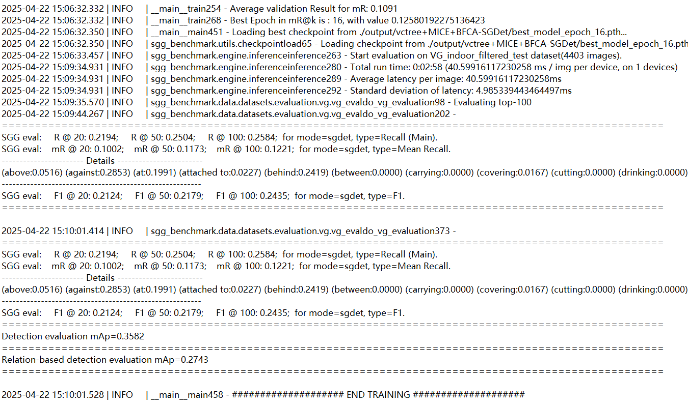

# Indoor-Scene-Graph-Generation
CRMS-Net: A Multiscale Relational Network for Unbiased Indoor Scene Graph Generation


**ABSTRACT**

Scene Graph Generation (SGG) aims to represent visual scenes as structured graphs comprising objects and their pairwise relationships, serving as a foundational step for complex visual reasoning. However, current SGG models still face significant challenges in fine-grained relation prediction. Specifically, the long-tailed distribution of predicates inherently biases model predictions toward frequent classes, while conventional single-scale context modeling often restricts the representation of fine-grained relational cues in complex scenes. Therefore, this paper proposes the Channel-Recalibrated Multi-Scale Relational Network (CRMS-Net), a modular framework that enhances relation prediction by integrating Channel Recalibration Attention (CRA) with a Multi-Scale Instance Context Encoder (MICE) through two synergistic core modules. First, the CRA constructs a perturbed counterpart of the original relation representation and exploits the contrast between the original and perturbed features to estimate channel-wise recalibration weights, aiming to reduce excessive reliance on individual feature channels. Furthermore, the MICE aggregates contextual cues at multiple scales through parallel dilated branches and incorporates relation-level semantic-consistency regularization during training. Additionally, CRMS-Net can be integrated with different relation heads, including Motifs, VCTree, and Transformer. Extensive experiments on the IndoorVG, VG150, and PSG show improvements across several relation-head and evaluation-metric configurations, with gains varying across settings. Notably, for the scene graph detection task on the IndoorVG dataset, CRMS-Net equipped with the Motifs head achieves an R@100 of 39.22 and an mR@100 of 21.73, confirming the effectiveness of the proposed mechanisms.


This repository includes the code for scene graph generation on three datasets VG, OpenPSG and Indoor.

Basic operating requirement:

```
pip install -r requirements.txt
```

# Contents

```
.
├── build/
├── checkpoints/
├── configs/
├── datasets/
├── output/
├── tests/
├── tools/
├── TRAINING/
├── .gitignore
├── LICENSE
├── README
├── requirements
└── setup.py
```

VG_dataset

Download the VG annotations dataset

Download the evaluation folder evaluation

Download the yolov8 object detection pre-trained model 

Then put them into the VG_dataset folder

### Evalution

SGG PredCls evalution on VG

SGG PredCls evalution on PSG

SGG PredCls evalution on Indoor

## result


